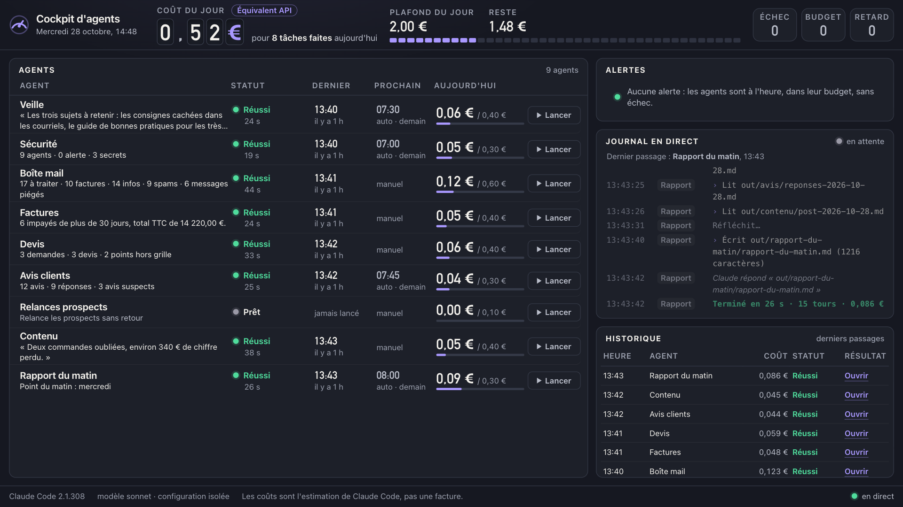

# Cockpit d'agents



## Ce que c'est

Un cockpit local qui lance des agents Claude Code. Sur une seule page, vous voyez leur journal en direct, ce que chacun a fait aujourd'hui et ce qu'il a coûté (l'estimation de Claude Code, en équivalent API, pas une facture). Chaque agent a un budget par jour, et un plafond par jour (2 € dans `config.json`) s'applique à l'ensemble.

La démo a 9 agents d'exemple : Veille, Sécurité, Boîte mail, Factures, Devis, Avis clients, Relances prospects, Contenu et Rapport du matin. Ils travaillent sur des données fictives.

## Le lancer en 2 commandes

```
git clone https://github.com/OdenPistol/cockpit-agents.git && cd cockpit-agents
```

```
npm start
```

Le cockpit s'ouvre dans votre navigateur sur http://127.0.0.1:4321. Ctrl+C dans le Terminal l'arrête.

Un agent part quand vous cliquez sur « Lancer », ou tout seul à son heure prévue : quatre agents en ont une, entre 07:00 et 08:00.

Option : faire tourner chaque agent une fois, à la suite, avec le coût total à la fin.

```
npm run essai
```

Les huit agents lancés ont coûté 0,495 € en équivalent API à l'essai du 28/10/2026, et 0,577 € à celui du 21/10/2026. Relances prospects est sauté : son budget de 0,10 € est sous l'estimation d'un passage (0,15 €), exprès, pour que vous voyiez le cockpit refuser un agent dont le budget ne suffit pas.

## Ce qu'il ne fait pas encore

- Pas de commande à la voix : tout se fait au clic.
- Il tourne sur votre ordinateur, pas dans le cloud. Ordinateur éteint ou cockpit fermé à l'heure prévue : rien ne part, et l'alerte « en retard » le dit au lancement suivant. Si vous l'ouvrez en journée, les quatre agents planifiés sont donc signalés « en retard » tant qu'ils n'ont pas tourné aujourd'hui : c'est normal.
- Le coût d'un passage n'est connu qu'à la fin. Un passage en cours n'est pas coupé par le budget : c'est le suivant qui est bloqué.
- Les données de démo sont fictives, y compris les faux secrets de `data/divers/`, là pour que l'agent Sécurité ait quelque chose à trouver. Les agents lisent ces données et n'envoient rien.
- Il n'est branché à aucun vrai outil (messagerie, facturation, avis).

## Créer un agent

Créez un dossier dans `agents/`, par exemple `agents/mon-agent/`, avec un fichier `agent.md` : un en-tête (nom, description, budget par jour, outils, nombre de tours maximal, heure facultative), puis la consigne en français. Rechargez la page : l'agent apparaît.

Le format ligne par ligne, avec un exemple à copier, est dans le [README complet](docs/README-complet.md#ajouter-un-agent). Il détaille aussi les budgets, les droits des outils, la configuration isolée et le lancement au démarrage du Mac.

## Ce qu'il vous faut

- Un ordinateur (Mac, Windows ou Linux), Node 22 ou plus, et Claude Code (abonnement Claude ou clé API).
- Testé sur macOS ; sous Windows et Linux, l'ouverture du navigateur est prévue (src/demarrage.js) mais pas encore testée.

Le cockpit est gratuit, Claude Code ne l'est pas : chaque passage d'un agent est pris sur votre abonnement ou facturé sur votre clé API.

Licence MIT.
