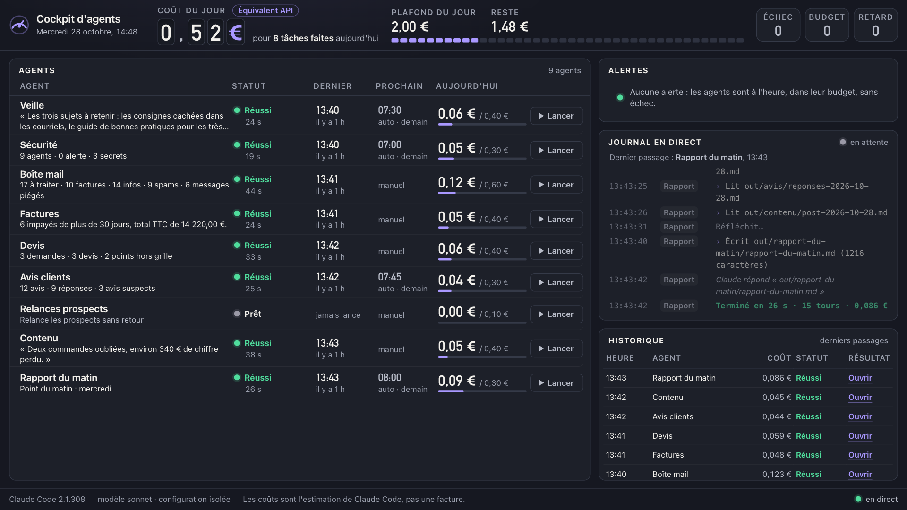

# Cockpit d'agents



## Ce que c'est

Un cockpit local qui lance des agents Claude Code. Sur une seule page, vous voyez leur journal en direct, ce que chacun a fait aujourd'hui et ce qu'il a coûté (l'estimation de Claude Code, en équivalent API, pas une facture). Chaque agent a un budget par jour, et un plafond par jour (2 € dans `config.json`) s'applique à l'ensemble.

La démo a 10 agents d'exemple : Veille, Sécurité, Boîte mail, Factures, Juge, Devis, Avis clients, Relances prospects, Contenu et Rapport du matin. Ils travaillent sur des données fictives.

## Le lancer en 2 commandes

```
git clone https://github.com/OdenPistol/cockpit-agents.git && cd cockpit-agents
```

```
npm start
```

Le cockpit s'ouvre dans votre navigateur sur http://127.0.0.1:4321. Ctrl+C dans le Terminal l'arrête.

Le port 4321 est déjà pris, par une autre copie du cockpit par exemple ? Lancez `PORT=4322 npm start` : aucun fichier n'est modifié, l'autre copie n'est pas touchée, et l'adresse affichée au démarrage est la bonne (c'est elle qu'il faut ouvrir).

Un agent part quand vous cliquez sur « Lancer », ou tout seul à son heure prévue : quatre agents en ont une, entre 07:00 et 08:00.

Option : faire tourner chaque agent une fois, à la suite, avec le coût total à la fin.

```
npm run essai
```

Les huit agents lancés ont coûté 0,495 € en équivalent API à l'essai du 28/10/2026, et 0,577 € à celui du 21/10/2026. Relances prospects est sauté : son budget de 0,10 € est sous l'estimation d'un passage (0,15 €), exprès, pour que vous voyiez le cockpit refuser un agent dont le budget ne suffit pas. Le Juge n'est pas lancé par l'essai : il vérifie le travail d'un autre agent, au clic.

## Nouvelle version : l'agent Juge

Un second agent vérifie le travail du premier avant que vous vous en serviez, avec des critères écrits d'avance. Version 1.1.0 (voir le [CHANGELOG](CHANGELOG.md)). Le principe en cinq lignes :

- Les critères sont écrits **avant** le travail, dans une « definition of done » : un fichier `dod.md` de trois à cinq critères vérifiables, dans le dossier de l'agent (par exemple `agents/factures/dod.md`). [Comment l'écrire](docs/ecrire-une-dod.md).
- Un second agent, le Juge, compare le travail de l'agent à ces critères, un par un, et écrit un verdict : ACCEPTÉ ou REJETÉ, avec des corrections numérotées et leur preuve.
- Celui qui juge ne produit pas : le Juge ne corrige jamais, il n'a que les outils Read et Write et n'écrit que dans `out/juge/`.
- Sous l'agent vérifié, l'écran affiche « Vérifié par le Juge : accepté » ou « Rejeté : 1 correction » ; un clic ouvre le verdict.
- Rien ne repart seul : un rejet attend votre décision, « Relancer avec les corrections » ou rien.

Pour l'essayer : lancez le cockpit, cliquez sur « Lancer » à droite de Factures, attendez la fin de son passage, puis cliquez sur « Lancer le Juge » sous son nom. Le fichier `data/factures/factures.csv` contient une erreur plantée exprès (le total TTC de la facture F-2026-0079 est faux). Le plus souvent, le Juge la relève et rejette la sortie (4 rejets sur 4 jugements à la mesure du 29/10/2026). Il peut arriver que Factures repère l'erreur lui-même : le Juge accepte alors du premier coup. Remettez à zéro (`npm run remise-a-zero`) et relancez Factures. Après un rejet, cliquez sur « Rejeté » pour lire le verdict, puis sur « Relancer avec les corrections », puis de nouveau sur « Lancer le Juge » : il accepte (trois fois sur trois à la même mesure).

Un cycle complet (rejet, relance, accord) coûte environ 0,20 € en équivalent API. Le Juge a son propre budget par jour (0,40 €), compté dans le plafond comme celui des autres agents : cela fait environ 8 passages du Juge par jour. `npm run remise-a-zero` vide `out/` et `journal/` (les sorties et l'historique des agents, rien d'autre) et efface donc aussi le compteur du plafond du jour : à faire entre deux prises, pas pendant qu'un agent tourne.

## Ce qu'il ne fait pas encore

- Pas de commande à la voix : tout se fait au clic.
- Il tourne sur votre ordinateur, pas dans le cloud. Ordinateur éteint ou cockpit fermé à l'heure prévue : rien ne part, et l'alerte « en retard » le dit au lancement suivant. Si vous l'ouvrez en journée, les quatre agents planifiés sont donc signalés « en retard » tant qu'ils n'ont pas tourné aujourd'hui : c'est normal.
- Le coût d'un passage n'est connu qu'à la fin. Un passage en cours n'est pas coupé par le budget : c'est le suivant qui est bloqué.
- Les données de démo sont fictives, y compris les faux secrets de `data/divers/`, là pour que l'agent Sécurité ait quelque chose à trouver. Les agents lisent ces données et n'envoient rien.
- Il n'est branché à aucun vrai outil (messagerie, facturation, avis).
- Le Juge est un modèle, comme l'agent qu'il vérifie : il peut se tromper, dans les deux sens. Son verdict est un avis sur des critères écrits d'avance, pas une preuve. Seul Factures a une definition of done dans la démo.

## Créer un agent

Créez un dossier dans `agents/`, par exemple `agents/mon-agent/`, avec un fichier `agent.md` : un en-tête (nom, description, budget par jour, outils, nombre de tours maximal, heure facultative), puis la consigne en français. Rechargez la page : l'agent apparaît.

Le format ligne par ligne, avec un exemple à copier, est dans le [README complet](docs/README-complet.md#ajouter-un-agent). Il détaille aussi les budgets, les droits des outils, la configuration isolée et le lancement au démarrage du Mac. Pour qu'un agent soit vérifié par le Juge, ajoutez un fichier `dod.md` dans son dossier.

## Ce qu'il vous faut

- Un ordinateur (Mac, Windows ou Linux), Node 22 ou plus, et Claude Code (abonnement Claude ou clé API).
- Testé sur macOS ; sous Windows et Linux, l'ouverture du navigateur est prévue (src/demarrage.js) mais pas encore testée.
- Testé avec Claude Code 2.1.308 (29/10/2026). Si votre version est plus ancienne, tapez `claude update`.

Le cockpit est gratuit, Claude Code ne l'est pas : chaque passage d'un agent est pris sur votre abonnement ou facturé sur votre clé API.

Licence MIT.
